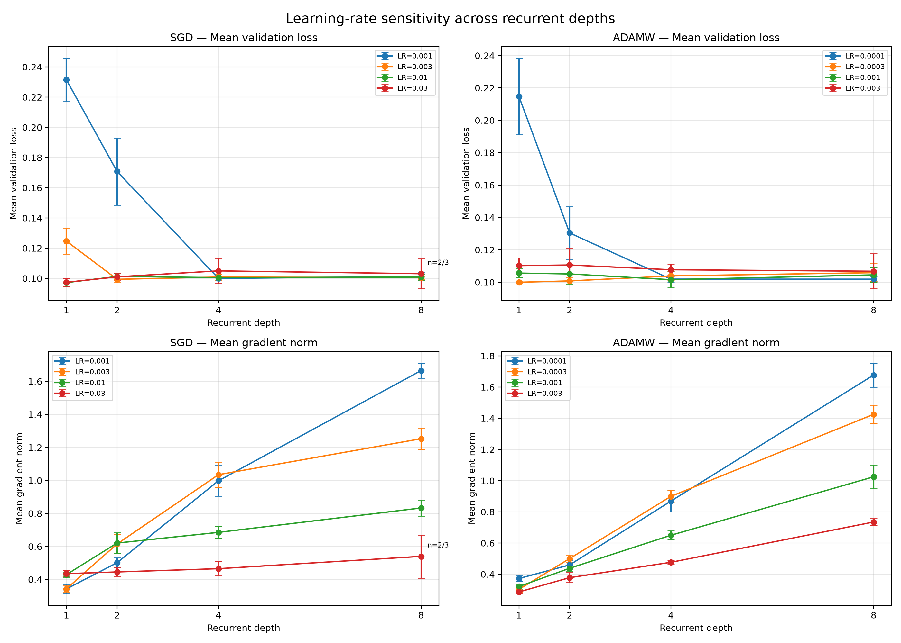
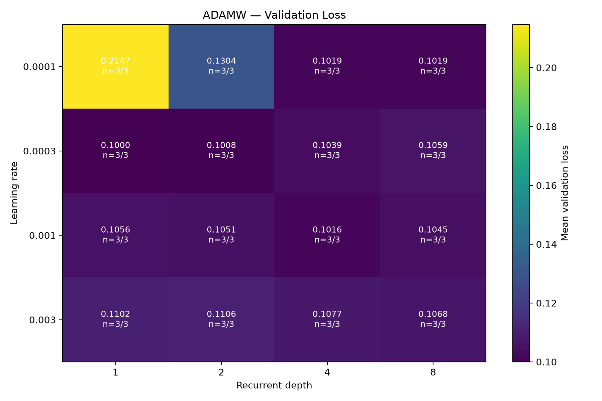
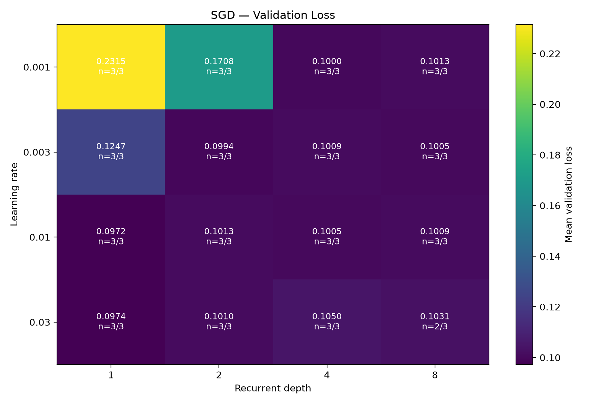

# Optimization Behaviour in Weight-Tied Looped Neural Networks

**A PyTorch implementation and experimental study of optimization behaviour across recurrent depth and learning-rate configurations.**

---

## Overview

This repository contains an implementation of a weight-tied looped neural network and an experimental framework for examining its optimization behaviour under different recurrent depths and optimizer configurations.

The network repeatedly applies the same residual transformation to its hidden representation. Unlike a conventional feed-forward network, increasing its recurrent depth does not introduce a separate set of parameters for every iteration. The same transformation is reused throughout the forward pass.

The project focuses on three implementation and experimental components:

- A shared-weight recurrent network implemented in PyTorch.
- Custom implementations of SGD with momentum and AdamW.
- Controlled experiments examining recurrent depth, learning rate, validation performance, gradient norms, and numerical stability.

The initial experiments use the Two Moons classification dataset as a controlled synthetic benchmark. The objective of this stage is to establish a working experimental pipeline, verify optimizer implementations, and characterize the behaviour of the implemented model under a limited set of configurations.

This repository should be understood as an experimental implementation and diagnostic study, rather than a claim of a new optimization algorithm.

---

## 1. Network Architecture

### 1.1 Shared-weight looped network

Let \(h_0\) denote the initial hidden representation obtained from the input projection.

The network repeatedly applies a shared transformation:

\[
h_{t+1}=h_t+F_\theta(\operatorname{LayerNorm}(h_t))
\]

where:

- \(h_t\) is the hidden representation at iteration \(t\).
- \(F_\theta\) is a residual transformation.
- \(\theta\) represents the shared parameters.
- Layer normalization is applied before the transformation.

The same parameterized transformation is used at every recurrent step.

After the final iteration, an output projection maps the hidden representation to the classification logits.

### 1.2 Shared residual block

The implemented block consists of:

1. Layer normalization.
2. Linear projection from the hidden dimension to twice the hidden dimension.
3. GELU activation.
4. Linear projection back to the original hidden dimension.
5. Residual addition.

For a hidden dimension of 64, the intermediate feed-forward dimension is 128.

The architecture can be summarized as:

```text
Input
  |
  v
Input Projection
  |
  v
Shared Residual Block
  |
  +------ Repeated N times
  |
  v
Output Projection
  |
  v
Classification Logits
```

### 1.3 Why parameter sharing matters

In a conventional network, increasing the number of layers generally introduces additional parameters.

In this implementation, increasing recurrent depth increases the number of applications of the shared transformation, not the number of independently parameterized blocks.

This makes it possible to investigate how repeated application of the same learned transformation affects optimization and model behaviour.

---

## 2. Optimization Algorithms

Two optimizers are implemented directly using the PyTorch optimizer interface.

### 2.1 SGD with momentum

The custom SGD implementation follows the classical momentum update:

\[
v_t=\mu v_{t-1}+g_t
\]

\[
\theta_t=\theta_{t-1}-\eta v_t
\]

where:

- \(g_t\) is the current gradient.
- \(\mu\) is the momentum coefficient.
- \(\eta\) is the learning rate.
- \(v_t\) is the momentum buffer.

The momentum buffer is initialized using the first gradient.

Weight decay is implemented as coupled L2 regularization by adding the parameter contribution to the gradient before updating the momentum buffer.

Implementation: `src/optimizers/sgd.py`

### 2.2 AdamW

The custom AdamW implementation maintains exponentially weighted first and second moments:

\[
m_t=\beta_1m_{t-1}+(1-\beta_1)g_t
\]

\[
v_t=\beta_2v_{t-1}+(1-\beta_2)g_t^2
\]

The moments are corrected for initialization bias:

\[
\hat m_t=\frac{m_t}{1-\beta_1^t}
\]

\[
\hat v_t=\frac{v_t}{1-\beta_2^t}
\]

The parameter update uses:

\[
\theta_t=
\theta_{t-1}(1-\eta\lambda)
-
\eta\frac{\hat m_t}{\sqrt{\hat v_t}+\epsilon}
\]

where \(\lambda\) is the decoupled weight-decay coefficient.

Implementation: `src/optimizers/adamw.py`

### 2.3 Implementation scope

These are deliberately focused implementations of the specified optimizer variants. They do not attempt to reproduce every optional feature available in PyTorch's built-in optimizers.

Reference tests compare the custom implementations against corresponding PyTorch optimizer behaviour for the tested configurations.

---

## 3. Experimental Setup

### 3.1 Dataset

The initial experiments use the Two Moons dataset generated through scikit-learn.

| Parameter | Setting |
|---|---:|
| Dataset | Two Moons |
| Number of samples | 2,000 |
| Noise | 0.2 |
| Validation fraction | 0.2 |
| Input dimensions | 2 |
| Number of classes | 2 |
| Random seeds | 42, 123, 2026 |

The data is split into training and validation subsets. Standardization is fitted on the training data and subsequently applied to the validation data.

This avoids fitting preprocessing statistics using validation samples.

### 3.2 Model configuration

| Parameter | Value |
|---|---:|
| Input dimension | 2 |
| Hidden dimension | 64 |
| Output dimension | 2 |
| Recurrent depths | 1, 2, 4, 8 |
| Shared residual transformation | Yes |
| Hidden activation | GELU |
| Normalization | LayerNorm |

### 3.3 Training configuration

| Parameter | Value |
|---|---:|
| Epochs per run | 15 |
| Batch size | 64 |
| Loss function | Cross-entropy |
| Optimizers | SGD Momentum, AdamW |
| Random seeds | 3 per configuration |

The experiments use the configurations defined in the YAML files under `configs/`.

---

## 4. Experiments

### 4.1 Initial depth and optimizer experiment

The first experiment matrix evaluates four recurrent depths, two optimizers, and three random seeds.

| Variable | Configurations |
|---|---|
| Recurrent depth | 1, 2, 4, 8 |
| Optimizer | SGD, AdamW |
| Seeds | 42, 123, 2026 |

Total:

\[
4\times2\times3=24\text{ runs}
\]

The optimizer settings are:

| Parameter | SGD | AdamW |
|---|---:|---:|
| Learning rate | 0.01 | 0.001 |
| Momentum | 0.9 | — |
| Weight decay | 0.0 | 0.01 |

This initial experiment provides a baseline across the selected configurations. Since the learning rates and weight-decay settings differ, its results should not be interpreted as a fully controlled comparison of optimizer superiority.

Configuration: `configs/experiment_matrix.yaml`

Runner: `experiments/run_experiments.py`

### 4.2 Learning-rate sensitivity experiment

A second experiment examines multiple learning rates at each recurrent depth.

The experiment contains:

- Four recurrent depths.
- Two optimizers.
- Four learning rates per optimizer.
- Three random seeds.

**SGD learning rates**

```text
0.001
0.003
0.010
0.030
```

**AdamW learning rates**

```text
0.0001
0.0003
0.0010
0.0030
```

The total number of attempted runs is:

\[
2\times4\times4\times3=96
\]

The learning-rate values are preliminary experimental settings used to examine sensitivity within the chosen training budget. They are not presented as generally optimal learning rates.

Configuration: `configs/learning_rate_experiment.yaml`

Runner: `experiments/run_learning_rate_sweep.py`

### 4.3 Metrics

The training pipeline records:

- Training loss.
- Training accuracy.
- Validation loss.
- Validation accuracy.
- Gradient norm.
- Epoch execution time.
- Total run execution time.

For gradient measurements, the norm is computed over all available parameter gradients after backpropagation and before the optimizer update.

The reported epoch-level gradient norm is the arithmetic mean of the individual minibatch gradient norms. It is not the norm of an epoch-aggregated gradient.

---

## 5. Experimental Results and Visualizations

The following figures summarize the learning-rate sensitivity experiments across four recurrent depths. Results are aggregated across three random seeds, with incomplete configurations explicitly identified.

### 5.1 Learning-rate sensitivity across recurrent depths

The plots show mean validation loss and mean minibatch gradient norm as functions of recurrent depth for SGD and AdamW.

Error bars represent ±1 standard deviation across successful random seeds.



*Figure 1. Validation loss and gradient-norm statistics across recurrent depths and learning-rate configurations.*

### 5.2 AdamW: validation-loss sensitivity

The heatmap displays mean validation loss for each combination of learning rate and recurrent depth. Each cell reports the number of successful runs relative to the total number of runs.



*Figure 2. AdamW validation-loss heatmap. All configurations completed three runs.*

### 5.3 SGD: validation-loss sensitivity

The corresponding SGD heatmap shows the variation in validation loss across its learning-rate configurations.

One configuration, depth 8 at learning rate 0.03, contains only two successful runs. Its incomplete sample count is retained in the visualization.



*Figure 3. SGD validation-loss heatmap. The depth-8, learning-rate-0.03 configuration completed two of three runs.*

### 5.4 Interpretation notes

The figures provide a descriptive view of optimization behaviour under the tested experimental conditions.

Several configurations show increasing gradient norms with recurrent depth, while validation-loss patterns vary with learning rate and optimizer.

These observations are specific to the implemented architecture, dataset, training budget, and tested configurations. They should not be interpreted as general claims about optimizer superiority or recurrent-network stability.

---

## 6. Statistical Analysis and Preliminary Results

### 6.1 Learning-rate sweep execution statistics

The 96-run learning-rate sweep produced the following execution statistics:

| Result | Count |
|---|---:|
| Total runs | 96 |
| Completed runs | 95 |
| Non-finite runs | 1 |
| Overall completion rate | 98.96% |
| Overall non-finite rate | 1.04% |

The single non-finite run occurred under:

| Parameter | Value |
|---|---:|
| Optimizer | SGD |
| Learning rate | 0.03 |
| Recurrent depth | 8 |
| Seed | 2026 |

The other two seeds for this configuration completed successfully.

### 6.2 Numerical instability investigation

The failed configuration was reproduced using a dedicated diagnostic script.

During the reproduction, the loss, gradient norm, maximum gradient magnitude, and maximum parameter magnitude were monitored.

The diagnostic showed rapidly increasing values during the second epoch, followed by a non-finite loss at epoch 2, batch 11.

This is consistent with numerical divergence in that particular run.

The result does not establish that depth 8 is generally unstable, nor does it isolate learning rate as the only contributing factor.

Diagnostic implementation: `experiments/debug_unstable_run.py`

### 6.3 Gradient-norm observations

The statistical summary shows increasing mean minibatch gradient norms with recurrent depth in several learning-rate configurations.

For example, under AdamW with learning rate 0.0001:

| Recurrent depth | Mean gradient norm |
|---:|---:|
| 1 | 0.37269 |
| 2 | 0.45962 |
| 4 | 0.86924 |
| 8 | 1.67749 |

This pattern is worth further investigation.

A larger gradient norm alone does not demonstrate exploding gradients. Additional diagnostics, including gradient distributions, parameter-update magnitudes, and behaviour over training time, would be needed to characterize the underlying mechanism.

### 6.4 Interpretation limits

The results should be interpreted within the limits of the current experimental design:

1. Only three random seeds were used per configuration.
2. Training was limited to 15 epochs.
3. The benchmark is a synthetic binary classification dataset.
4. SGD and AdamW use different learning-rate grids and different weight-decay settings.
5. Failed runs are excluded from performance means but retained in failure statistics.
6. The standard deviation for the incomplete SGD depth-8, learning-rate-0.03 configuration is based on two successful runs rather than three.

These experiments provide an initial diagnostic characterization of the implemented system. They do not establish a general optimizer ranking or a theoretical result about looped networks.

---

## 7. Repository Structure

```text
looped-network-study/
│
├── configs/
│   ├── baseline.yaml
│   ├── experiment_matrix.yaml
│   └── learning_rate_experiment.yaml
│
├── src/
│   ├── models/
│   │   └── looped_network.py
│   │
│   ├── optimizers/
│   │   ├── sgd.py
│   │   └── adamw.py
│   │
│   └── training/
│       ├── metrics.py
│       ├── reproducibility.py
│       └── trainer.py
│
├── experiments/
│   ├── inspect_model.py
│   ├── train_baseline.py
│   ├── load_config.py
│   ├── run_experiments.py
│   ├── verify_experiments.py
│   ├── analyse_results.py
│   ├── audit_results.py
│   ├── run_learning_rate_sweep.py
│   ├── debug_unstable_run.py
│   ├── plot_learning_rate_heatmaps.py
│   ├── audit_learning_rate_results.py
│   ├── analyse_learning_rate_results.py
│   └── plot_learning_rate_statistics.py
│
├── tests/
│   ├── test_model.py
│   ├── test_optimizers.py
│   ├── test_optimizer_reference.py
│   └── test_training.py
│
├── results/
│   ├── metrics/
│   ├── figures/
│   └── learning_rate_sensitivity/
│       ├── figures/
│       ├── individual_runs/
│       ├── experiment_summary.csv
│       └── statistical_summary.csv
│
├── requirements.txt
├── .gitignore
└── README.md
```

---

## 8. Installation

### Requirements

- Python 3.10 or later.
- PyTorch.
- NumPy.
- Pandas.
- Matplotlib.
- scikit-learn.
- PyYAML.
- pytest.
- tqdm.

### Windows PowerShell

Clone the repository:

```powershell
git clone <YOUR_REPOSITORY_URL>
cd looped-network-study
```

Create a virtual environment:

```powershell
python -m venv .venv
```

Activate it:

```powershell
.\.venv\Scripts\Activate.ps1
```

Install dependencies:

```powershell
python -m pip install --upgrade pip
pip install -r requirements.txt
```

Check the PyTorch installation:

```powershell
python -c "import torch; print(torch.__version__); print(torch.cuda.is_available())"
```

The training pipeline supports CPU execution and can use CUDA when available and configured.

---

## 9. Running the Experiments

Run the baseline experiment:

```powershell
python experiments/train_baseline.py
```

Run the initial experiment matrix:

```powershell
python experiments/run_experiments.py
```

Verify the initial experiment outputs:

```powershell
python experiments/verify_experiments.py
```

Run the learning-rate sweep:

```powershell
python experiments/run_learning_rate_sweep.py
```

Investigate the unstable configuration:

```powershell
python experiments/debug_unstable_run.py
```

Audit the learning-rate results:

```powershell
python experiments/audit_learning_rate_results.py
```

Generate the statistical summary:

```powershell
python experiments/analyse_learning_rate_results.py
```

Generate the learning-rate heatmaps:

```powershell
python experiments/plot_learning_rate_heatmaps.py
```

Generate the depth-statistics figures:

```powershell
python experiments/plot_learning_rate_statistics.py
```

Run the test suite:

```powershell
pytest -v
```

---

## 10. Reproducibility

The project includes a reproducibility utility for controlling random seeds across Python, NumPy, and PyTorch.

Experiment configurations are stored separately from the training code in YAML files.

Each run is associated with its:

- Random seed.
- Recurrent depth.
- Optimizer.
- Learning rate.
- Training configuration.
- Recorded metrics.
- Completion status.

The learning-rate sweep produces individual run records and an experiment summary. The integrity audit checks expected configurations, unique run identifiers, seed coverage, and finite metrics for completed runs.

For an exact reproduction, use the same dependency versions, configuration files, random seeds, device type, and source revision.

Deterministic settings do not guarantee bitwise-identical results across all hardware and software environments.

---

## 11. Testing

The test suite covers the core implementation.

**Model tests**

- Output dimensionality.
- Shared parameter behaviour across recurrent depth.
- Backpropagation.
- Invalid model configurations.

**Optimizer tests**

- Update behaviour.
- Momentum and moment calculations.
- Weight decay.
- Comparison with reference PyTorch implementations.

**Training tests**

- Forward and backward training execution.
- Training and evaluation behaviour.
- Metric generation.

Run all tests with:

```powershell
pytest -v
```

---

## 12. Current Limitations and Further Work

The current implementation is an initial experimental framework. Several improvements remain important before drawing broader conclusions.

- Extend the evaluation beyond a single synthetic dataset.
- Examine optimization behaviour over longer training schedules.
- Increase the number of random seeds.
- Investigate the interaction between recurrent depth, initialization, and learning rate.
- Record more detailed gradient and parameter-update diagnostics.
- Improve early detection and recording of non-finite training values.
- Expand controlled comparisons between optimizer configurations.
- Document the exact software and hardware environment used for each experiment.

Any future optimizer comparisons should control relevant experimental variables and distinguish performance differences from differences in tuning budgets.

---

## 13. References

The implementation is based on established optimization methods and neural-network components.

- Kingma, D. P., & Ba, J. (2015). *Adam: A Method for Stochastic Optimization*. International Conference on Learning Representations (ICLR).
- Loshchilov, I., & Hutter, F. (2019). *Decoupled Weight Decay Regularization*. International Conference on Learning Representations (ICLR).
- Ioffe, S., & Szegedy, C. (2015). *Batch Normalization: Accelerating Deep Network Training by Reducing Internal Covariate Shift*. International Conference on Machine Learning (ICML).
- Paszke, A., et al. (2019). *PyTorch: An Imperative Style, High-Performance Deep Learning Library*. Advances in Neural Information Processing Systems.

---

## Project Status

The shared-weight network, custom optimizer implementations, initial experiment matrix, learning-rate sweep, numerical instability investigation, statistical analysis, and result-integrity checks have been implemented.

The training pipeline is undergoing further review, particularly around numerical safeguards and metric consistency.

This repository is intended to remain an actively developed experimental project. Results should be interpreted in the context of the configurations and limitations documented above.
